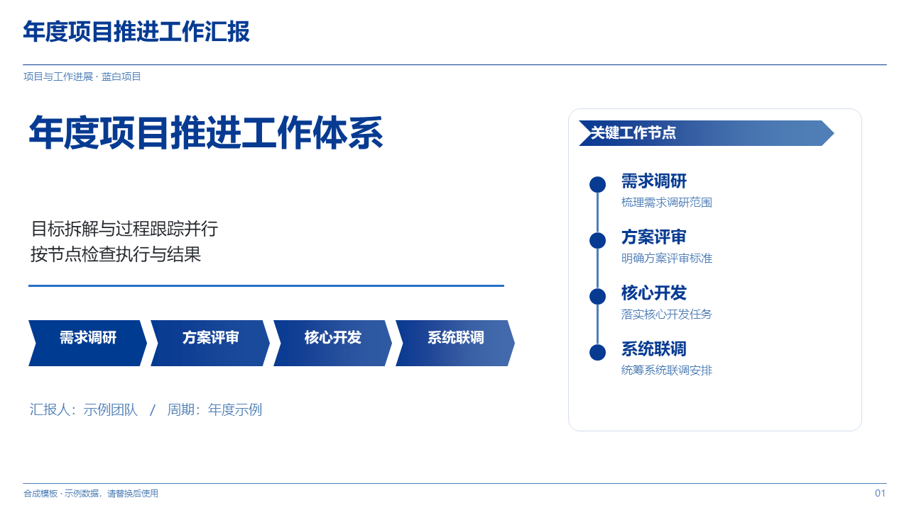
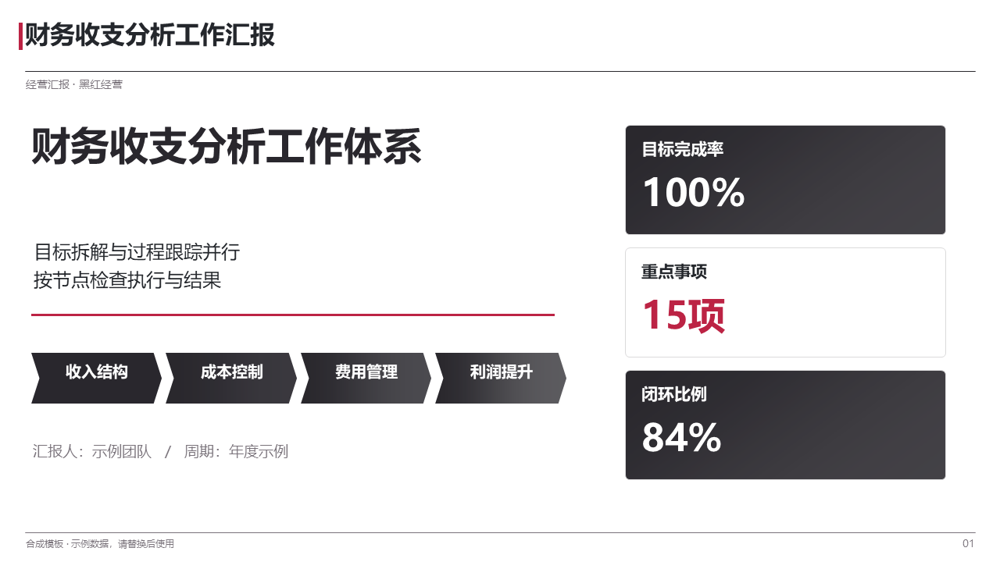
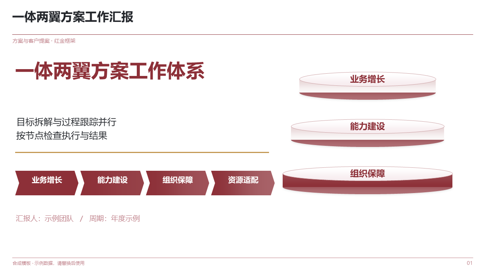

<h1 align="center">Work Skills</h1>

<p align="center">
  打工人专用的 Agent 技能集。<br>
  每个技能一个自包含目录，放进所用助手的技能目录即可使用。
</p>

<p align="center">
  
  
  
</p>

---

## 工作汇报 PPT

**v1.4.2 · MIT · Python 3.10+ · PowerPoint / WPS**

把工作资料变成可编辑汇报 PPT 的技能。它不急着排版：

1. **先问清楚。** 用途、受众、时长页数、核心结论、资料范围、内容限制逐项确认；含糊、缺失或存在多种解释时停下来等回答，不假设、不代填。
2. **再算准。** 核对期间、单位、分母与粒度，用脚本重算目标差距、同比环比与分组贡献；目标差距桥接不闭合就拒绝出稿。
3. **分清事实和推测。** 观察事实、待验证假说、材料支持的解释三类分开，页面结论只能引用类型化字段，不能再自由发挥一份摘要。
4. **逐页确认后才生成。** 提纲带着真实内容、绑定数值和行动前提；计划改动一次，批准就作废一次。
5. **交付前逐页看。** 校验字号、行高、字体与边界，渲染出图核对，代表页做编辑—保存—重开。

随包 **30 套六页模板、10 套配色、34 类原生版式、662 项离线素材**，覆盖经营汇报、项目进展、客户提案、培训、营销、研究六类场景。

### 安装

```console
git clone https://github.com/Daylily-Huang/Work-skills.git

# macOS / Linux
cp -r Work-skills/skills/work-report-ppt ~/.workbuddy/skills/

# Windows PowerShell
Copy-Item -Recurse Work-skills\skills\work-report-ppt "$env:USERPROFILE\.workbuddy\skills\"
```

然后对助手说：

> 用 work-report-ppt 做这个季度的工作汇报。先问我场景、配色和要讲给谁听，再根据我给的数据核对口径、算清差距，出逐页提纲等我确认后再生成。

命令、版式、配色与质量门禁的细节见 [技能 README](skills/work-report-ppt/README.md)。

---

## 教学课件 PPT

**v1.0.2 (trial) · MIT · Python 3.10+ (无额外依赖) · PowerPoint / WPS**

面向小学、初高中优先、大学兼容的专门教学课件制作与改稿技能。它按教学逻辑与课堂现场来组织页面：

<p align="center">
  
  
  
</p>

1. **先问清关键边界。** 课题、受众、课型、授课时长、必讲点与教材出处先核清；影响目标与内容的重要歧义没有真实回答或授权依据时拒绝推进。
2. **模板按学段、课型与场景避坑选配。** 随包 **20 套六页轻量模板（120 页）与 65 项开放矢量图标**：`T01`–`T12` 面向说课与教研（带顶部导航与学情图表/表格），`T13`–`T20` 面向一线课堂新授、讨论与观察记录，支持按 `visual_scene` / `avoid_for` 避开背景器物穿帮。
3. **教学约束可脚本核对。** 校验必讲点全覆盖、活动与目标绑定、整节课活动总时长不少于半课时、事实来源追溯、问题页教师指导答案及 324 处方括号与常见模板字样拦截，并对反复循环/交替版式、超容风险和风格混用给出复核提示。
4. **原生可编辑并支持旧稿微调。** 完整拷贝 OOXML 关系图保留多色标题、原生表格与嵌入 XLSX 图表工作簿；`local_edit` 模式自动去重共享母版/媒体并增量保留原页面教师备注。
5. **PowerPoint 实机渲染与双端探针。** 逐页导出 PNG 检查文字与表格溢出，并对文本、表格及嵌入图表工作簿副本实际写入—保存—重开验证。

### 安装

```console
git clone https://github.com/Daylily-Huang/Work-skills.git

# macOS / Linux
cp -r Work-skills/skills/teacher-ppt ~/.workbuddy/skills/
cp -r Work-skills/skills/teacher-ppt ~/.codex/skills/

# Windows PowerShell
Copy-Item -Recurse Work-skills\skills\teacher-ppt "$env:USERPROFILE\.workbuddy\skills\"
Copy-Item -Recurse Work-skills\skills\teacher-ppt "$env:USERPROFILE\.codex\skills\"
```

然后对助手说：

> 用 $teacher-ppt，帮我做七年级语文阅读讨论片段课件，10分钟，重点是根据人物动作描写读出人物特点；先核对短文材料再设计问题与活动。

工作流、门禁、二级改稿与模板目录细节见 [教学课件 README](skills/teacher-ppt/README.md)。

---

## 许可

本仓库技能代码与文档采用 [MIT](LICENSE)；随包第三方素材各自遵循原许可（CC0 / CC BY / ISC / MIT / Apache-2.0），逐项记录在各技能目录的许可与溯源清单（`work-report-ppt` 见 `assets/media-library/catalog.json` 与 `THIRD_PARTY_NOTICES.md`，`teacher-ppt` 见 `references/template-provenance.json` 与 `assets/licenses/`）。
