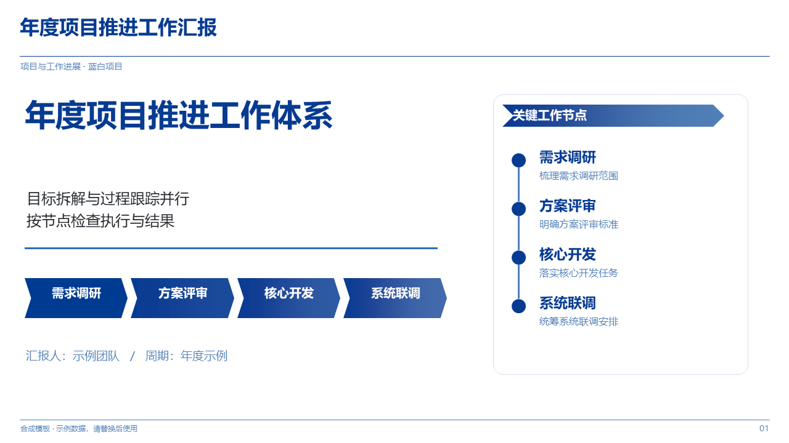
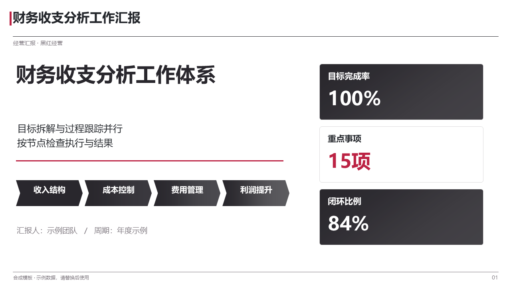
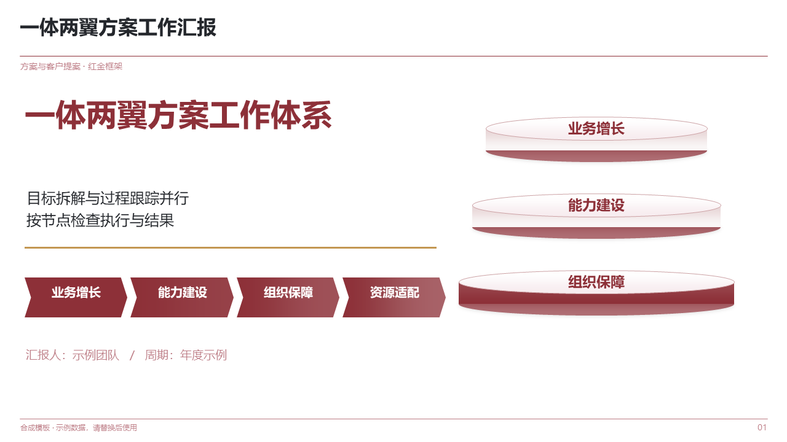

<h1 align="center">Work Skills</h1>

<p align="center">
  打工人专用的 Agent 技能集。<br>
  每个技能一个自包含目录，放进所用助手的技能目录即可使用。
</p>

<p align="center">
  
  
  
</p>

---

## 工作汇报 PPT

**v1.4.2 · MIT · Python 3.10+ · PowerPoint / WPS**

把工作资料变成可编辑汇报 PPT 的技能。它不急着排版：

1. **先问清楚。** 用途、受众、时长页数、核心结论、资料范围、内容限制逐项确认；含糊、缺失或存在多种解释时停下来等回答，不假设、不代填。
2. **再算准。** 核对期间、单位、分母与粒度，用脚本重算目标差距、同比环比与分组贡献；目标差距桥接不闭合就拒绝出稿。
3. **分清事实和推测。** 观察事实、待验证假说、材料支持的解释三类分开，页面结论只能引用类型化字段，不能再自由发挥一份摘要。
4. **逐页确认后才生成。** 提纲带着真实内容、绑定数值和行动前提；计划改动一次，批准就作废一次。
5. **交付前逐页看。** 校验字号、行高、字体与边界，渲染出图核对，代表页做编辑—保存—重开。

随包 **30 套六页模板、10 套配色、34 类原生版式、662 项离线素材**，覆盖经营汇报、项目进展、客户提案、培训、营销、研究六类场景。

### 安装

```console
git clone https://github.com/Daylily-Huang/Work-skills.git

# macOS / Linux
cp -r Work-skills/skills/work-report-ppt ~/.workbuddy/skills/

# Windows PowerShell
Copy-Item -Recurse Work-skills\skills\work-report-ppt "$env:USERPROFILE\.workbuddy\skills\"
```

然后对助手说：

> 用 work-report-ppt 做这个季度的工作汇报。先问我场景、配色和要讲给谁听，再根据我给的数据核对口径、算清差距，出逐页提纲等我确认后再生成。

命令、版式、配色与质量门禁的细节见 [技能 README](skills/work-report-ppt/README.md)。

---

## 许可

本仓库技能代码与文档采用 [MIT](skills/work-report-ppt/LICENSE)；随包第三方素材各自遵循原许可（CC0 / CC BY / ISC / MIT / Apache-2.0），逐项记录在各技能的 `assets/media-library/catalog.json` 与 `THIRD_PARTY_NOTICES.md`。
