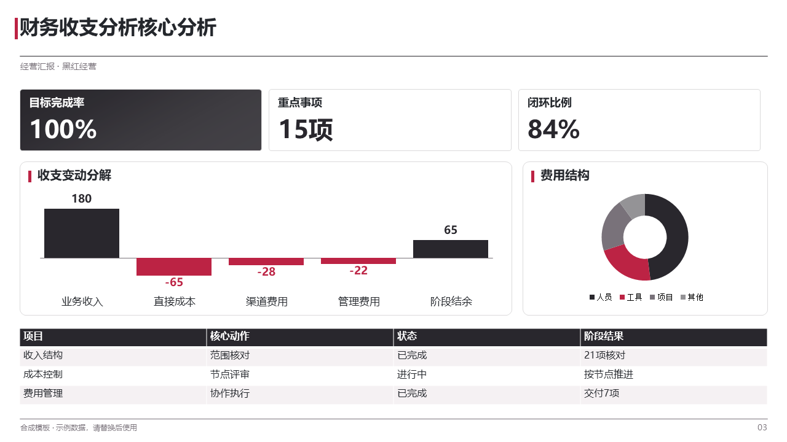
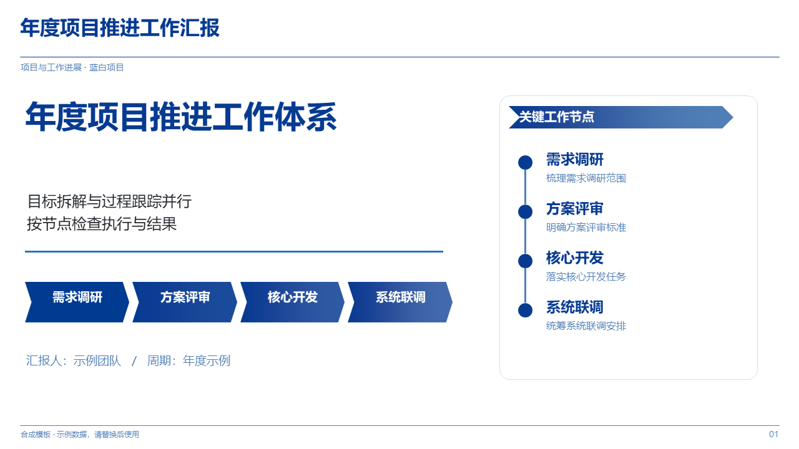
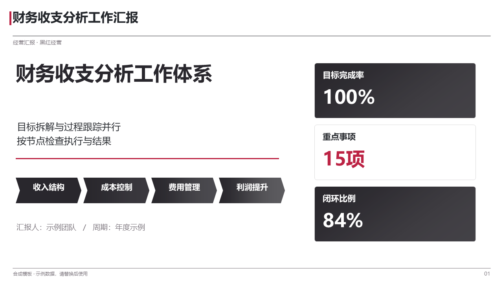
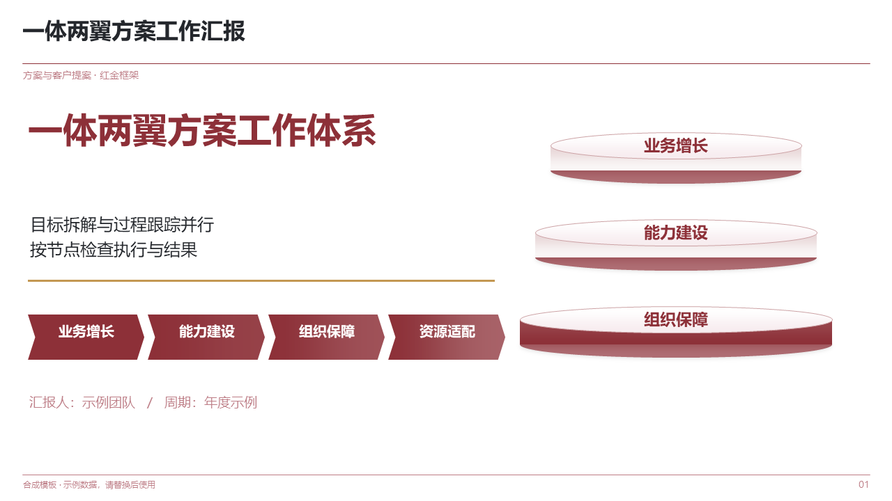

<h1 align="center">工作汇报 PPT</h1>

<p align="center">
  先把需求问清楚，再把数字算准，最后才排版。<br>
  交付一份能打开、能编辑、每一页都说得清依据的 PPTX。
</p>

<p align="center">
  <code>v1.4.2</code>　·　MIT　·　Python 3.10+　·　PowerPoint / WPS
</p>

<p align="center">
  
</p>

<p align="center">
  <sub>随包模板的合成示例。指标卡、瀑布图、环形图与表格都是可编辑的原生对象，不是贴图。</sub>
</p>

---

<p align="center">
  <b>30 套六页模板　·　10 套配色　·　34 类原生版式　·　662 项离线素材</b><br>
  <sub>六类场景：经营汇报 · 项目进展 · 客户提案 · 培训 · 营销 · 研究</sub>
</p>

**它不拿模板套你的内容。** 版式跟着信息关系走——要比较就用对比页，要归因就用瀑布图，要排期就用甘特。脚本会拒绝明显循环，但选中之后每一页仍要按新内容重新排。

## 它不是为了让你排版更快

多数 AI 做 PPT 的失败点不在美术，而在三件事：没问清要讲给谁听、数字口径对不上、十几页其实是同一个三栏结构换了颜色。这个技能把这三件事做成硬门禁，过不了就不出稿。

| 常见做法 | 这里的做法 |
| --- | --- |
| 一句话下单就开始配色排版 | 用途、受众、时长与页数、核心结论、资料范围、内容限制、设计约束逐项问清；含糊、缺失、矛盾或存在多种解释时停下来等回答，不假设、不代填 |
| 数字从聊天记录里抄，口径各页不一 | 先定期间、单位、范围、指标定义、分母与唯一粒度，再用 `analyze.py` 重算差距、同比环比、分组贡献与加权比率；目标差距桥接不闭合就拒绝出稿 |
| 结论、推测、猜测混在同一段话里 | 观察事实 / 待验证假说 / 材料支持的解释三类分开；页面核心信息只能引用 `narrative.claims` 的类型化结论，不能再自由发挥一份摘要 |
| 全篇都是三栏卡片换色 | 34 类原生版式按信息关系选页；脚本查明显循环，相邻页与跨章节仍须人工复核，改名换色伪装同构一样退回 |
| 交付时才第一次打开文件 | 生成即校验字号与行高（同一套公式），渲染逐页看，代表页做编辑—保存—重开三步验证 |

## 六个阶段，每一道都留痕

| 阶段 | 动作 | 卡住的条件 |
| --- | --- | --- |
| **1 澄清** | `design_gate.py` 校验用途、受众、结论、资料范围与设计约束 | 任一字段含糊、缺失、矛盾；`--draft` 也不能绕过 |
| **2 定方案** | 场景 → 配色 → 模板族 / 填充风格 → 素材 | 用户已明确选择或明确授权代选，不重复问、不另加生图环节 |
| **3 主线与证据** | 目标、结果、差距、解释、行动、决策请求；声明比较基准与适用范围 | 结论缺基准/范围/强度/前提；行动缺前提、反例、副作用；请求缺两个以上选项 |
| **4 数据分析** | `analyze.py` 计算目标差距、同比环比、变化贡献、加权比率 | 口径有歧义、桥接不闭合、数据质量问题未解决 |
| **5 逐页计划** | `outline.py` 生成含真实内容与绑定数值的提纲；`approve_plan.py` 记录用户确认原文、计划哈希与提纲哈希 | 计划任何改动都使批准失效，必须重新确认 |
| **6 制作与验收** | `generate.py` 出稿；`audit.py` 与渲染核验；编辑保存重开 | 文本溢出、正文低于 11pt、表格低于 12pt、字体越界、素材拉伸 |

## 三分钟上手

在本目录运行（先探测环境，确认缺依赖时才安装 `requirements.txt`）：

```console
python -X utf8 scripts/environment.py

# 1 需求与方案
python -X utf8 scripts/design_gate.py task/design-selection.json

# 2 口径与计算（没有定量数据可整段跳过）
python -X utf8 scripts/analyze.py --config task/analysis-contract.json --output task/analysis.json

# 3 逐页计划与提纲
python -X utf8 scripts/outline.py --input task/deck-plan.json --analysis task/analysis.json \
  --output task/outline.md --plan-output task/prepared-plan.json

# 4 记录用户对提纲的真实确认
python -X utf8 scripts/approve_plan.py --plan task/prepared-plan.json --outline task/outline.md \
  --mode confirmed --quote "用户确认原文" --confirm

# 5 生成与审计
python -X utf8 scripts/generate.py --input task/prepared-plan.json --output output/my-presentation.pptx

python -X utf8 scripts/audit.py output/my-presentation.pptx \
  --expected-font "Microsoft YaHei" --disclosure "模拟数据"
```

`examples/operating-review/` 与 `examples/project-update/` 是可跑通的合成演示（前者先用同目录 `analysis-contract.json` 生成 `analysis.json`，再以 `--analysis` 绑定）；它们只作结构与写法参考，真实业务不得沿用其中的澄清与授权记录。

需要渲染逐页核验时，先看 `assets/gallery.html` 选方向，再用随包脚本：

```console
powershell -File scripts/render_powerpoint.ps1 -Source output/my-presentation.pptx `
  -OutputDir output/previews -ExpectedFont "Noto Sans SC,Noto Serif SC"
```

标题与正文分属两款字体时，把家族名用逗号连写。生成阶段报文本超框时，用 `PPT_TEXT_REPORT=1` 一次列出全部超框位置再统一修，别逐个试错：

```console
PPT_TEXT_REPORT=1 python -X utf8 scripts/generate.py --input task/prepared-plan.json --output output/my-presentation.pptx
```

## 包里有什么

<p align="center">
  
  
  
</p>

<p align="center">
  <sub>三种样式族：蓝白、黑红、红金。换族只换配色，版式结构不跟着改。</sub>
</p>

### 六类场景，三十套六页模板

| 场景 | 内容侧重 | 模板数 | 示例 |
| --- | --- | ---: | --- |
| 经营汇报 `business` | 指标、原因、项目与改进 | 8 | 财务收支分析、经营绩效看板 |
| 项目与工作进展 `project` | 排期、依赖、资源与交付 | 6 | 年度项目推进、交付里程碑 |
| 方案与客户提案 `proposal` | 目标、结构、价值与落地 | 5 | 一体两翼方案、业务价值链 |
| 培训与团队建设 `training` | 流程、能力、练习与检查 | 5 | 标准作业流程、复盘治理闭环 |
| 营销与用户运营 `marketing` | 触达、转化、留存与复盘 | 4 | 转化漏斗分析、渠道获客效率 |
| 研究与评估 `research` | 问题、维度、样本与边界 | 2 | 用户分层研究、能力评估模型 |

`templates/T01.pptx` 到 `T30.pptx` 是可查看的六页合成样例与组件来源。**生成器并不打开这些 pptx**：模板选择只决定样式族（蓝白 / 黑红 / 红金）与参考版式，三十套文件不代表三十种可独立生成的视觉设计——按内容选页、组合、调整，不循环整套。

### 十套配色

| 配色 | 名称 | 主色 | 点缀 | | 配色 | 名称 | 主色 | 点缀 |
| --- | --- | --- | --- | --- | --- | --- | --- | --- |
| P1 | 经典宝蓝 | `#073B92` | `#2A6FC3` | | P6 | 石墨绯红 | `#29272D` | `#BC2344` |
| P2 | 浅蓝商务 | `#245C91` | `#154C80` | | P7 | 中国红金 | `#AB302D` | `#C88F34` |
| P3 | 海军蓝青 | `#123E67` | `#16889D` | | P8 | 酒红粉白 | `#8D3038` | `#C39752` |
| P4 | 钴蓝灰白 | `#174EB0` | `#2D68CD` | | P9 | 玫瑰香槟 | `#B94D62` | `#B58D50` |
| P5 | 黑红经营 | `#141414` | `#D92128` | | P10 | 政企红白 | `#B6292D` | `#B78230` |

三族轮转而非十套独立设计：`blue` 蓝白、`black` 黑红、`red` 红金。配色定义与取色依据见 `assets/palettes.json`。

### 三十四类原生版式

封面、结论页、指标卡、数据表、对比、风险、时间线、甘特、泳道、漏斗、金字塔、价值链、六项支柱、能力环、WBS、看板、评分卡、留存矩阵等。基础版式与 `office_*` 商务版式共用同一套页眉与建表实现（`scripts/chrome.py`），改一处视觉语言即全局生效。

### 662 项离线素材

Bioicons、Servier、Lucide、Tabler、Maki、Temaki、Noto 七套图标与插画，`assets/media-library/catalog.json` 逐项记录原始作者、固定提交、来源 URL、路径、哈希与许可。其中 332 项带原生缓存，可在 PowerPoint 内改色、移动、组合缩放。查询与插入不需要联网，也不需要 Office。

```console
python -X utf8 scripts/assets.py search 供应链
```

## 作为 Agent Skill 使用

把**整个目录**放进所用助手的技能目录，保持 `SKILL.md`、`scripts/`、`assets/`、`references/`、`templates/` 的相对关系：

```console
~/.workbuddy/skills/work-report-ppt/
~/.codex/skills/work-report-ppt/
~/.agents/skills/work-report-ppt/
```

然后对助手说：

> 用 work-report-ppt 做这个季度的工作汇报。先问我场景、配色和要讲给谁听，再根据我给的数据核对口径、算清差距，出逐页提纲等我确认后再生成。

## 质量结论怎么读

审计输出是三个互不替代的判定，不能合成一句"通过"：

| 字段 | 含义 | 不覆盖什么 |
| --- | --- | --- |
| `technical_integrity_ok` | 能打开、无溢出、无过小字号、编辑保存重开正常 | 不证明内容正确 |
| `presentation_quality_ok` | 字号、字体白名单、几何位置与边界检查通过 | 不等于视觉认可，仍须逐页目视 |
| `semantic_validation` | 固定为 `not_performed` | 事实、口径与解读须人工核对 |

脚本只能约束结构，不能替你判断这一段话该不该出现在这一页。

## 目录结构

```text
work-report-ppt/
├── SKILL.md                 技能入口：门禁规则、阶段流程与命令
├── LICENSE                  MIT（第三方素材各自许可）
├── THIRD_PARTY_NOTICES.md   素材来源与许可边界
├── requirements.txt         python-pptx / Pillow / openpyxl
├── scripts/
│   ├── environment.py       探测 Python、依赖与 Office
│   ├── design_gate.py       需求澄清门禁
│   ├── analyze.py           口径校验与数值计算
│   ├── outline.py           逐页计划投影为提纲
│   ├── approve_plan.py      记录真实确认与哈希
│   ├── generate.py          基础版式渲染
│   ├── commercial_layouts.py 商务版式渲染（office_*）
│   ├── chrome.py            页眉与数据表格的唯一实现
│   ├── audit.py             结构、字号、字体、边界审计
│   ├── assets.py            素材检索与原生插入
│   └── render_powerpoint.ps1 调用 PowerPoint 渲染逐页预览
├── references/              撰写、口径、版式、文案与逻辑细则
├── examples/                合成示例：经营复盘、项目进展、方案提案
├── templates/               T01–T30 六页模板（仅作样式与组件参考）
├── assets/                  配色、设计目录、图库、模板预览
└── tests/                   回归与自检
```

## 开发与测试

```console
python -X utf8 -B tests/run_tests.py
```

回归覆盖：版式不溢出、绑定数值与重算结果一致、门禁拒绝路径、字体与字号阈值、表格容量、页眉与建表共用实现、以及包内自检项。

## 许可

代码、模板与本包文档采用 **MIT**，见 [LICENSE](LICENSE)。

随包素材不适用 MIT：Bioicons、Servier、Lucide、Tabler、Maki、Temaki、Noto 分别遵循 CC0、CC BY、ISC、MIT 与 Apache-2.0，逐项记录在 [catalog.json](assets/media-library/catalog.json)，许可全文在 [licenses/](assets/media-library/licenses/)。使用 CC BY 素材时保留页面可见署名。来源与边界说明见 [THIRD_PARTY_NOTICES.md](THIRD_PARTY_NOTICES.md)。

本包不含商业字体，也不含 PowerPoint、Excel、Python 或第三方库本体；运行依赖见 `requirements.txt`，Office 由使用者自行提供。
